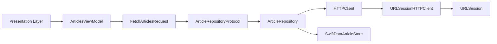
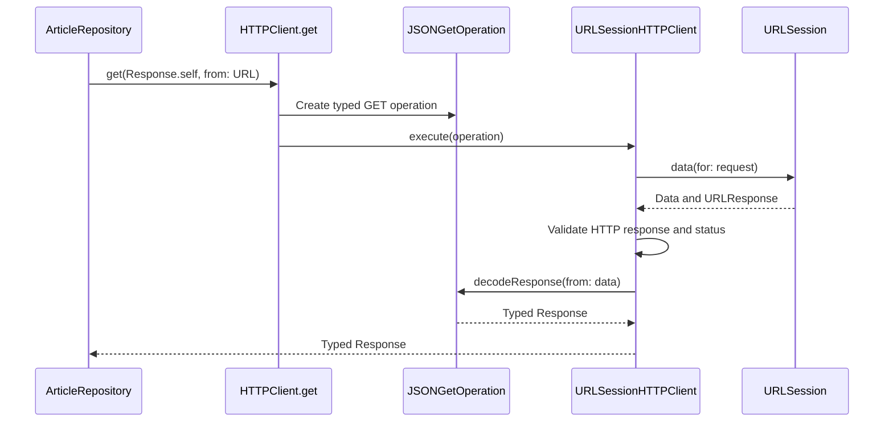
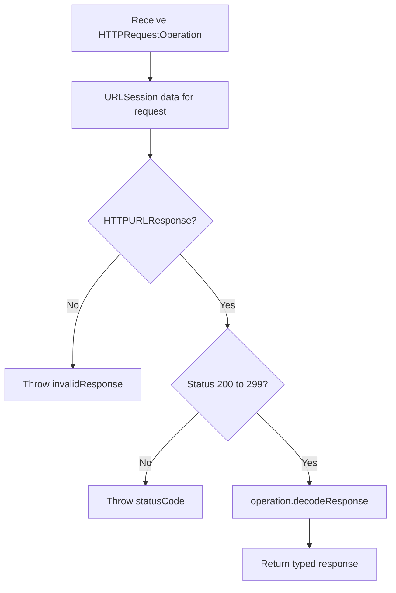
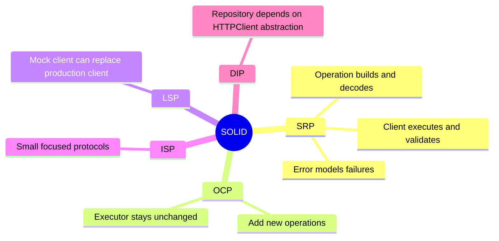
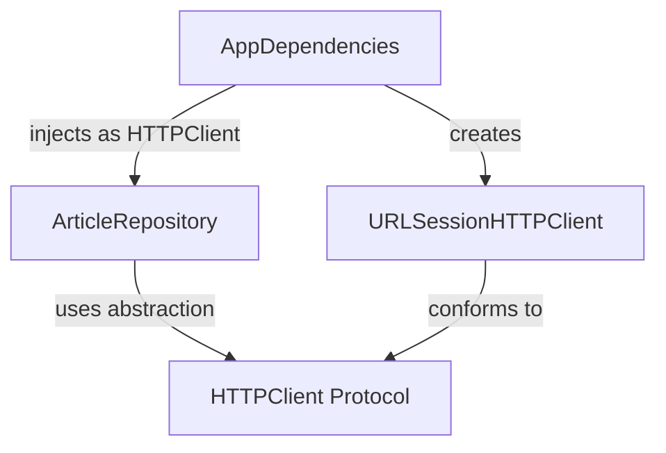

# HTTPClient Architecture

## Developer Knowledge Draft

The networking layer is a lightweight, type-safe abstraction over `URLSession`. It separates request definition, network execution, response validation, and response decoding.

---

## High-Level Architecture



The repository depends on the `HTTPClient` abstraction rather than directly depending on `URLSessionHTTPClient`.

---

## HTTP Request Flow



---

## Main Components

### `HTTPRequestOperation`

```swift
protocol HTTPRequestOperation {
    associatedtype Response
    var request: URLRequest { get }
    func decodeResponse(from data: Data) throws -> Response
}
```

An operation defines:

- The request that must be executed
- The expected response type
- How raw data becomes that response type

The `associatedtype Response` provides compile-time type safety. This resembles the Command pattern because the request and its response-processing behavior are packaged together. The decoding function also supplies a Strategy to the HTTP client.

### `HTTPClient`

```swift
protocol HTTPClient: Sendable {
    func execute<Operation: HTTPRequestOperation>(
        _ operation: Operation
    ) async throws -> Operation.Response
}
```

This protocol abstracts the transport mechanism. Consumers do not need to know whether the implementation uses `URLSession`, a mock, a cache, or another networking framework.

`Sendable` indicates that conforming clients are safe to pass across Swift concurrency boundaries.

### `HTTPClient.get`

```swift
extension HTTPClient {
    func get<T: Decodable>(
        _ type: T.Type,
        from url: URL,
        headers: [String: String] = [:]
    ) async throws -> T {
        try await execute(JSONGetOperation<T>(url: url, headers: headers))
    }
}
```

This convenience API hides the creation of `JSONGetOperation`. It is the clearest Facade-like part of the design.

### `URLSessionHTTPClient`

The production implementation:

1. Gets the operation's `URLRequest`.
2. Executes it through `URLSession`.
3. Confirms that the response is an `HTTPURLResponse`.
4. Accepts status codes in the `200..<300` range.
5. Delegates conversion of the returned data to the operation.



### `JSONGetOperation<Response>`

This operation creates a GET request and uses `JSONDecoder` to produce a `Decodable` response. Decoding errors are converted to `HTTPError.decodingFailed`.

### `DataGetOperation`

This operation creates a GET request and returns raw `Data`. It can support images, documents, and other binary resources without changing the HTTP client.

### `HTTPError`

```swift
enum HTTPError: LocalizedError {
    case invalidResponse
    case statusCode(Int)
    case decodingFailed(Error)
}
```

It provides consistent networking errors and readable descriptions. Transport errors such as offline connectivity and timeouts currently pass through from `URLSession` unchanged.

---

## Is It a Facade?

Partially. `HTTPClient.get` gives repositories a simple API and hides `URLRequest`, `URLSession`, response validation, and JSON decoding.

Facade is a design pattern here, not the complete application architecture. The networking design is more accurately described as:

- Protocol-oriented networking
- Dependency injection
- Command/Strategy-based request operations
- A facade-style convenience API
- Repository architecture at the data layer

---

## SOLID Principles



### Single Responsibility Principle

- `URLSessionHTTPClient` executes and validates HTTP requests.
- Operations define requests and response conversion.
- `HTTPError` represents networking failures.
- `ArticleRepository` coordinates remote and local data.

The principle is mostly followed. An operation owns both request creation and decoding, but those responsibilities are cohesive for this small typed-operation design.

### Open/Closed Principle

New response formats or HTTP operations can be added by defining new `HTTPRequestOperation` types. `URLSessionHTTPClient` does not need to be modified.

### Liskov Substitution Principle

A mock or alternative `HTTPClient` can replace `URLSessionHTTPClient` as long as it preserves the execution contract.

### Interface Segregation Principle

The protocols are focused. Implementations are not required to support unrelated concerns such as authentication, caching, logging, or uploads.

### Dependency Inversion Principle

`ArticleRepository` depends on `HTTPClient`, not on `URLSessionHTTPClient`. The concrete client is created in `AppDependencies` and injected into the repository.

---

## Dependency Composition



This composition makes production dependencies explicit and enables test doubles to be injected during testing.

---

## Summary

The networking layer provides:

- Strongly typed request-response relationships
- Separation between transport and response conversion
- Async/await execution
- Replaceable dependencies
- Support for JSON and raw-data responses
- A simplified facade for repositories
- Strong Open/Closed and Dependency Inversion compliance

Overall, this is a compact and appropriate design for the project's current networking requirements.
